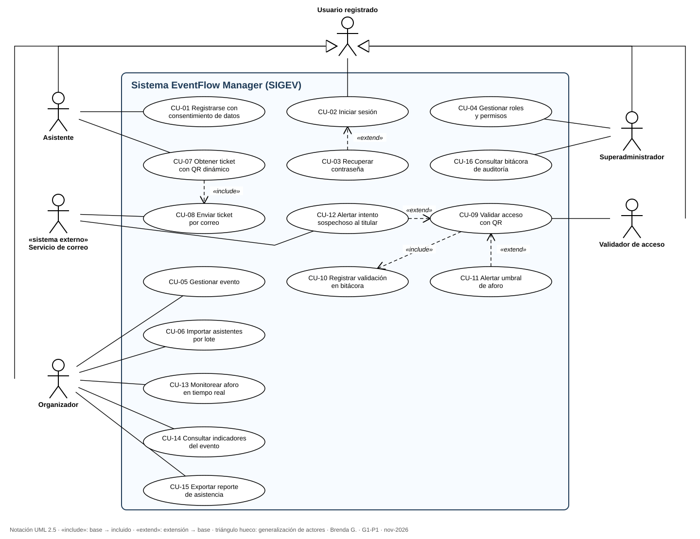

# 3. Diagrama de casos de uso: catálogo y justificación de relaciones

- **Fuente editable:** [`diagrama-casos-uso.drawio`](diagrama-casos-uso.drawio) (se abre en app.diagrams.net o en draw.io Desktop)
- **Imagen:** [`diagrama-casos-uso.png`](diagrama-casos-uso.png) · [`diagrama-casos-uso.svg`](diagrama-casos-uso.svg)

## 3.1 Actores

Todos los actores están **fuera** de la frontera del sistema.

| Actor | Tipo | Descripción |
|---|---|---|
| Usuario registrado | Primario (abstracto) | Generaliza a los cuatro roles con cuenta: todos inician sesión y recuperan su contraseña de la misma forma |
| Asistente | Primario | Se registra y obtiene su ticket para entrar al evento |
| Organizador | Primario | Crea y configura eventos, carga asistentes, monitorea el aforo y saca reportes |
| Validador de acceso | Primario | Escanea el QR en la puerta y decide el ingreso |
| Superadministrador | Primario | Administra roles y permisos y consulta la auditoría |
| Servicio de correo | Secundario («sistema externo») | Recibe y entrega los mensajes que el sistema envía (ticket, alerta al titular). No inicia ningún caso de uso |

## 3.2 Catálogo de casos de uso

Hay 16 casos de uso, todos nombrados con verbo + objeto.

| ID | Caso de uso | Iniciador | RF que atiende |
|---|---|---|---|
| CU-01 | Registrarse con consentimiento de datos | Asistente | RF1 |
| CU-02 | Iniciar sesión | Usuario registrado (todos los roles) | RF2 |
| CU-03 | Recuperar contraseña | Extiende CU-02 | RF3 |
| CU-04 | Gestionar roles y permisos | Superadministrador | RF4 |
| CU-05 | Gestionar evento | Organizador | RF5 |
| CU-06 | Importar asistentes por lote | Organizador | RF11 |
| CU-07 | Obtener ticket con QR dinámico | Asistente | RF6 |
| CU-08 | Enviar ticket por correo | Incluido por CU-07 | RF6 |
| CU-09 | Validar acceso con QR | Validador de acceso | RF8, RF7 |
| CU-10 | Registrar validación en bitácora | Incluido por CU-09 | RF12 |
| CU-11 | Alertar umbral de aforo | Extiende CU-09 | RF7 |
| CU-12 | Alertar intento sospechoso al titular | Extiende CU-09 | RF13 |
| CU-13 | Monitorear aforo en tiempo real | Organizador | RF7 |
| CU-14 | Consultar indicadores del evento | Organizador | RF9 |
| CU-15 | Exportar reporte de asistencia | Organizador | RF10 |
| CU-16 | Consultar bitácora de auditoría | Superadministrador | RF12 |

**Agrupación de CRUD (regla 1 de arbitraje):**
- **CU-05 Gestionar evento** agrupa crear, modificar, cancelar y parametrizar el aforo y las categorías de entrada. Todas tienen el mismo actor y las mismas reglas.
- **CU-04 Gestionar roles y permisos** agrupa asignar, cambiar y retirar roles.

No se separan porque ninguna de esas operaciones tiene un actor ni un flujo propio.

## 3.3 Justificación de relaciones

**Regla aplicada:** «include» es lo que **siempre** ocurre dentro del caso base y la flecha va del base al incluido. «extend» es lo **condicional**, con su punto de extensión, y la flecha va del que extiende al base.

| # | Relación | Tipo | Justificación (una línea) |
|---|---|---|---|
| R1 | CU-07 Obtener ticket → CU-08 Enviar ticket por correo | «include» | Cada vez que se emite un ticket **siempre** se envía al correo del asistente (RF6). Enviar el ticket es un paso obligatorio de la emisión, no una opción. |
| R2 | CU-09 Validar acceso → CU-10 Registrar validación en bitácora | «include» | **Toda** validación, concedida o denegada, queda registrada en la bitácora inmutable (RF12). No existe validación sin registro. |
| R3 | CU-03 Recuperar contraseña → CU-02 Iniciar sesión | «extend» | Solo ocurre **si** el usuario olvidó su contraseña. Punto de extensión: «¿Olvidó su contraseña?» en CU-02. |
| R4 | CU-11 Alertar umbral de aforo → CU-09 Validar acceso | «extend» | Solo se dispara **si**, después de conceder un ingreso, la ocupación llega al 80 % (alerta preventiva) o al 100 % (bloqueo). Punto de extensión: «Ocupación actualizada» en CU-09. |
| R5 | CU-12 Alertar intento sospechoso → CU-09 Validar acceso | «extend» | Solo se dispara **si** el código ya fue usado, está caducado o se reescanea en otra puerta en menos de 2 minutos (RF13). Punto de extensión: «Resultado denegado» en CU-09. |
| R6 | Asistente, Organizador, Validador de acceso y Superadministrador → Usuario registrado | Generalización de actores | Los cuatro roles heredan la asociación con CU-02 Iniciar sesión (y con su extensión CU-03), lo que evita dibujar 4 asociaciones repetidas. Cada rol conserva sus propios casos de uso. |

**Por qué "actualizar la ocupación" no es un «include»:** la ocupación solo aumenta cuando el acceso se **concede**, así que no ocurre siempre. Por eso es un paso del flujo principal de CU-09 y no un caso incluido. La alerta que depende de ella (CU-11) es condicional, y por eso es «extend».

## 3.4 Verificación de reglas UML aplicada

| Regla | ¿Cumple? | Evidencia |
|---|---|---|
| 8 o más casos de uso con nombre de verbo + objeto | Sí | 16 casos (sección 3.2) |
| 2 o más actores primarios | Sí | 5 actores primarios y 1 secundario |
| Actores fuera de la frontera del sistema | Sí | Rectángulo «Sistema EventFlow Manager (SIGEV)» con los actores afuera |
| Al menos 1 «include» y 1 «extend», justificados | Sí | 2 «include» y 3 «extend» (sección 3.3) |
| Sin ciclos entre include y extend | Sí | Ningún caso se incluye ni se extiende a sí mismo, directa o indirectamente |
| Sin casos duplicados | Sí | Cada caso atiende una función distinta (sección 3.2) |
| Todo caso tiene iniciador (regla 6) | Sí | Un actor primario o un caso base que lo incluye o lo extiende. El servicio de correo es solo secundario |
| Ningún «sistema interno» como actor | Sí | Se eliminó el actor "Sistema / Motor de aforo" de la versión anterior |
